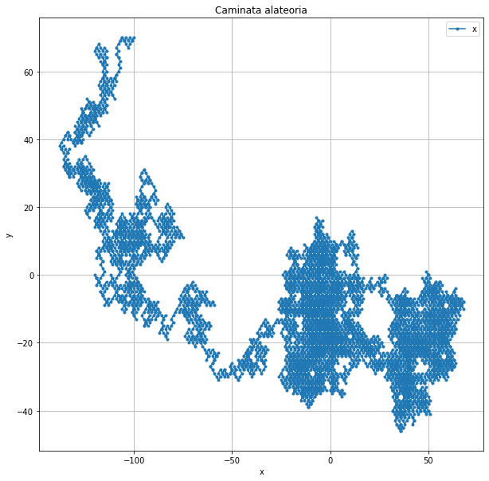
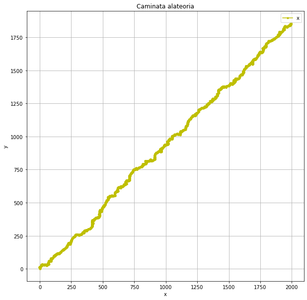
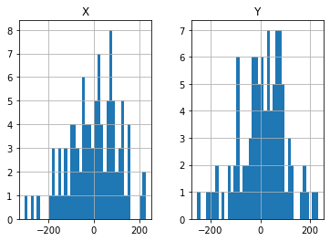
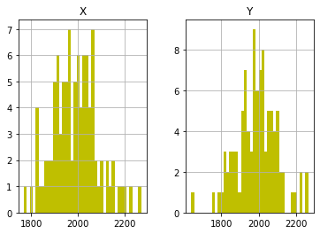

# Two-Dimensional Random Walks | Statistical Analysis

**Python · Statistical Analysis · Stochastic Processes · Data Visualization**

## Overview

This repository documents the **random-walk statistical analysis** from a broader undergraduate biophysics research project titled *Simulación Simplificada de Movimiento Browniano* (*Simplified Simulation of Brownian Motion*). The research also investigated interacting particles through Lennard–Jones simulations, presented in the original conference poster. The executable notebook and stored trajectory data in this repository focus on the random-walk component.

The notebook examines two-dimensional random walks by comparing particle trajectories under symmetric and directionally biased movement probabilities. The analysis uses stored trajectories for **100 particles per scenario**, with **10,000 recorded positions per particle**, and investigates how changes in step probabilities affect the distribution of particle positions.

The motivation is relevant to stochastic transport and biophysics, where directional bias may arise in the presence of an external gradient, for example the concentration of signaling molecules. The poster connects this simplified picture to colloidal systems and biological matter.

[**Explore the statistical analysis notebook**](Caminante%20semi-aleatorio.ipynb) · [**View the project poster**](Poster_Congreso.pdf)

## Research Questions

- How do endpoint positions vary across independent random-walk trajectories?
- What differences emerge between symmetric motion and directional bias?
- How do the position distributions compare at an early observation and at the end of the trajectories?
- How well do observed coordinate distributions agree with a Gaussian approximation?

## Simulation Conditions

The repository contains particle-coordinate files for four experimental conditions. The labels indicate the nominal probability of taking a positive-direction step in each coordinate.

| Condition | Positive X step | Positive Y step | Trajectories |
|---|---:|---:|---:|
| Symmetric | 50% | 50% | 100 |
| Biased in X and Y | 55% | 55% | 100 |
| Biased in X only | 60% | 50% | 100 |
| Stronger bias in X and Y | 60% | 60% | 100 |

Each trajectory file records positions in columns **X** and **Y**. The notebook compares positions at approximately step 100 and at the final recorded position, alongside selected full trajectories.

## Statistical Methodology

### 1. Particle trajectories and experimental design

For each probability condition, the analysis loads 100 independent trajectory files containing planar positions `(X, Y)`. The notebook studies the final recorded position (zero-based index 9999) and an early position (index 100). Individual trajectories are also plotted to illustrate the spatial differences between symmetric and biased walks.

A simple two-dimensional lattice-walk interpretation uses directional step probabilities `p_x` and `p_y`. If each step along an axis is +1 with probability `p` and −1 otherwise, the expected displacement after `n` steps is `n(2p−1)`, and the coordinate variance is `4np(1−p)`. These formulas motivate the comparison; the exact simulation rules and units would need to be verified against the trajectory-generation code, which is not included here.

### 2. Descriptive statistics and visual comparison

For each scenario and observation index, the notebook extracts the **X and Y positions across 100 particles** and reports their descriptive statistics. Boxplots show medians, dispersion and possible outliers; histograms visualize empirical coordinate distributions. Selected complete trajectories show the direction and variability of individual paths.

Comparing the early and final positions helps examine how distributions evolve as walks accumulate steps. Biased step probabilities are expected to introduce a systematic directional displacement, while stochastic variability remains across particles.

### 3. Normal-distribution fitting

The notebook fits a univariate Gaussian to the observed coordinates using `scipy.stats.norm.fit`, comparing fitted means and standard deviations with empirical estimates. This is consistent with the Gaussian approximation often associated with sums of many independent finite-variance steps. However, a fitted Gaussian is not proof of normality, and separate X/Y fits do not establish a bivariate Gaussian distribution.

### 4. Shapiro–Wilk normality testing

The notebook uses `scipy.stats.shapiro` at a stated significance threshold of **α = 0.05**. Its hypotheses are:

- **H₀:** the tested sample follows a normal distribution.
- **H₁:** the sample does not follow a normal distribution.

A p-value below 0.05 leads to rejection of H₀; a larger p-value indicates insufficient evidence to reject, **not proof** of a Gaussian distribution.

Some saved test outputs are reported below for transparency. **They are historical notebook outputs, not freshly rerun tests.** In several cells the code passes an entire two-column DataFrame to Shapiro–Wilk, so SciPy may flatten X and Y into one sample. That combined-coordinate result cannot be interpreted as a separate normality test for each axis.

| Scenario | Observation | Notebook sample | Saved p-value | Reading at α = 0.05 |
|---|---|---|---:|---|
| 50% / 50% | Final | X and Y DataFrame | 0.077 | Do not reject H₀ for the combined sample |
| 50% / 50% | Index 100 | X and Y DataFrame | 0.108 | Do not reject H₀ for the combined sample |
| 55% / 55% | Final | X and Y DataFrame | 0.495 | Do not reject H₀ for the combined sample |
| 55% / 55% | Index 100 | X and Y DataFrame | 0.067 | Do not reject H₀ for the combined sample |
| 60% / 50% | Final | X only | 0.804 | Do not reject H₀ for X |
| 60% / 50% | Final | Y only | 0.005 | Reject H₀ for Y |
| 60% / 60% | Final | X and Y DataFrame | 0.347 | Do not reject H₀ for the combined sample |

**Important coding caveat:** one cell in the 60% / 50% early-position section repeats the *final-position Y* Shapiro test rather than testing early-position Y. That saved output should not be interpreted as an independent result at index 100. The original analysis code has intentionally not been altered.

### 5. Random-number inspection

The notebook also examines stored pairs of generated random numbers, plotting samples with approximately **100, 1,000, 10,000, and 100,000 records**. These plots illustrate how uniform random inputs are used to choose directional movement, while sample fluctuations become easier to assess as sample size changes.

## Results and Interpretation

The notebook compares four cases: an unbiased walk, a modest bias on both axes, a stronger bias in X alone, and a stronger bias on both axes. The trajectory plots, coordinate histograms, and boxplots provide complementary views of directional displacement and statistical spread.

The saved normality results vary by scenario and by how the samples were supplied to the test. In particular, the 60% / 50% final-position Y sample yields **p = 0.005**, while the corresponding X sample yields **p = 0.804** in the stored outputs. This is a useful example of why coordinate-wise testing and sample definitions matter.

The central interpretation is **how directional probabilities shape ensemble displacement and dispersion**, rather than a claim that all simulated endpoint distributions are exactly normal.

## Results and Visualizations

### Representative trajectories: symmetric vs biased motion

The paths below are **original saved plots from the research notebook**, showing one example particle per condition. A single path illustrates possible behavior, but conclusions about ensemble averages require all trajectories.

| Symmetric random walk (50% / 50%) | Directionally biased walk (60% / 60%) |
|---|---|
|  |  |

The symmetric case has no nominal preferred direction; the 60% / 60% case favors positive steps in both coordinates. Individual trajectories still exhibit stochastic fluctuations.

### Endpoint distributions

Histograms summarize the final recorded X and Y coordinates **across 100 particles** in each of the two conditions.

| Symmetric endpoints (50% / 50%) | Biased endpoints (60% / 60%) |
|---|---|
|  |  |

These plots complement the Gaussian fitting and Shapiro–Wilk tests discussed above. They are empirical histograms, **not** overlaid theoretical Gaussian-fit curves. All four images were extracted from saved notebook outputs; no new simulation was run to create them.

## Analysis Notebook

[**Caminante semi-aleatorio.ipynb**](Caminante%20semi-aleatorio.ipynb)

This is the main analysis, including code, descriptive summaries, statistical tests and **34 saved plot outputs**. The notebook preserves the original code, Spanish commentary, and saved outputs. It is presented as an archival research analysis rather than a freshly re-executed software pipeline.

## Broader Research Context: Brownian Motion and Interacting Particles

The [original conference poster](Poster_Congreso.pdf), titled *Simulación Simplificada de Movimiento Browniano*, presents **two complementary modeling approaches**:

1. **Random-walk model (documented by this notebook):** direction choices generated from random numbers, comparing four probability settings. The poster shows ensembles of trajectories and endpoint histograms, emphasizing that directional preferences lead to collective drift.
2. **Interacting-particle model (presented in the poster):** Monte Carlo simulations with a **Lennard–Jones potential**, comprising a short-range repulsive term and a longer-range attractive term:

   \[V(r) = 4\varepsilon\left[\left(\frac{\sigma}{r}\right)^{12} - \left(\frac{\sigma}{r}\right)^6\right].\]

   The poster reports reduced number density **n* = 0.4**, reduced temperatures **T* = 1.500** and **0.7500**, and simulation panels labeled 15,000 and 100,000 steps. Its qualitative conclusion is that interacting particles fluctuate near relatively stable arrangements, unlike the more freely wandering random walkers. **The Lennard–Jones simulation code and corresponding data are not present in this repository; those results are documented through the poster only.**

The poster also references random-walk panels labeled **100,000 steps**, whereas the notebook here reads **10,000 stored positions per trajectory**. The README follows the notebook when describing its directly inspectable analysis and does not assume these are the same simulation runs.

The poster describes the random-walk results as compatible with Gaussian distributions based on Shapiro–Wilk testing, while the stored notebook contains some combined-coordinate tests and a Y-coordinate rejection (p = 0.005) in the 60% / 50% condition. Accordingly, the README reports the individual tests as recorded and does not claim universal normality.

## Conference Poster and Statistical Report

The project is also documented in its original research materials:

### Conference poster (Spanish)

[**View the original conference poster — Poster_Congreso.pdf**](Poster_Congreso.pdf)

The Spanish-language conference poster is retained in its original form as part of the project's scientific record. It presents the co-authored research, including both the random-walk analysis and the Lennard–Jones comparison. The English explanations in this README make the research questions, experimental conditions, statistical methods, and interpretive limitations accessible to a wider audience without altering the original poster.

### Statistical report (Spanish)

[**View the original statistics report — Estadística.pdf**](Estad%C3%ADstica.pdf)

The report is another primary project document and should be consulted alongside the notebook when examining the statistical analysis in depth.

*The original documents are preserved in Spanish rather than presented as translated originals. This README provides an English-language guide; it should not be treated as a line-by-line translation of either PDF.*

## Repository Structure

```text
Random-Walk-Statistical-Project/
├── Caminante semi-aleatorio.ipynb    # Main statistical analysis
├── Estadística.pdf                  # Original Spanish-language statistical report
├── Poster_Congreso.pdf               # Original Spanish-language conference poster
├── figures/                          # Selected original notebook plots
├── Números Aleatorios/               # Stored random-number samples
├── Partículas con 50% y 50%/         # 100 trajectories
├── Partículas con 55% y 55%/         # 100 trajectories
├── Partículas con 60% y 50%/         # 100 trajectories
├── Partículas con 60% y 60%/         # 100 trajectories
└── README.md
```

## How to Explore the Project

Install Python with `numpy`, `pandas`, `scipy`, `matplotlib` and Jupyter:

```bash
python -m pip install numpy pandas scipy matplotlib notebook
jupyter notebook "Caminante semi-aleatorio.ipynb"
```

Run the notebook from the **repository root**, keeping the existing trajectory folders alongside it. The data files are already stored in the repository.

## Limitations

- The analysis uses a finite ensemble of 100 trajectories per scenario; results fluctuate across samples.
- The data-loading code and notebook outputs have not yet been re-executed in a clean environment with current dependency versions.
- The notebook accesses specific observation indices, so interpretations should distinguish zero-based indices from step numbers.
- Some Shapiro–Wilk tests were applied to a two-column DataFrame rather than to X and Y separately; interpret these saved results as combined-sample tests, not coordinate-wise evidence.
- One early-position Y test in the 60% / 50% section repeats the final-position Y sample. This is documented above but not corrected in the original notebook.
- A Gaussian fit to marginal coordinates does not establish a bivariate Gaussian joint distribution.
- The poster covers additional Lennard–Jones simulations that are **not reproducible from the uploaded notebook alone**.
- Some step counts on the poster differ from the length of the stored notebook trajectories; they should not be treated as identical runs without the original simulation provenance.
- The stored trajectory dataset is large. Its full inclusion supports inspection but makes cloning the repository heavier.

---

**Portfolio:** [Data Science & Analytics Portfolio](https://github.com/ClaudethClarissa/data-science-portfolio)
